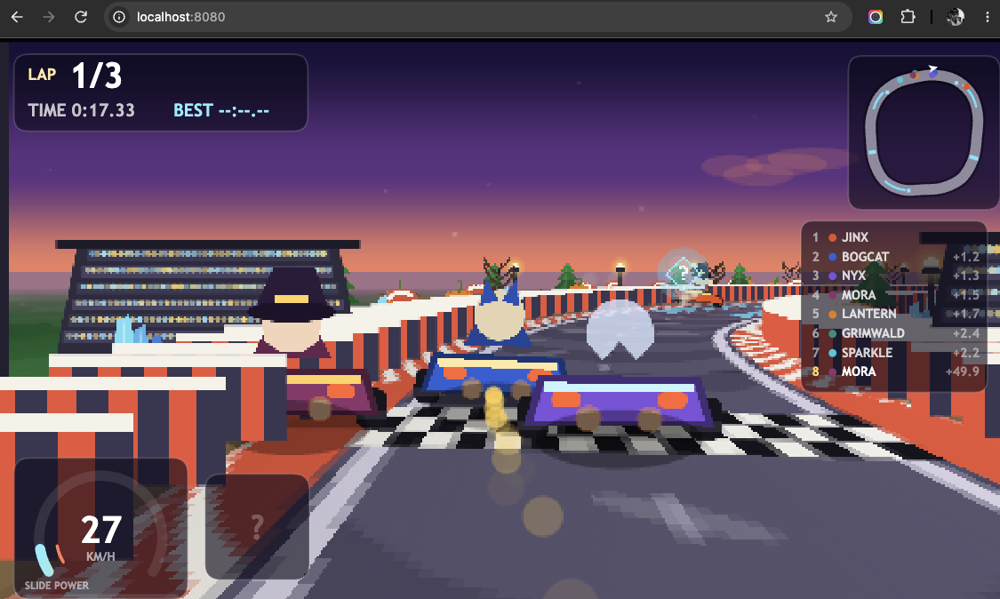
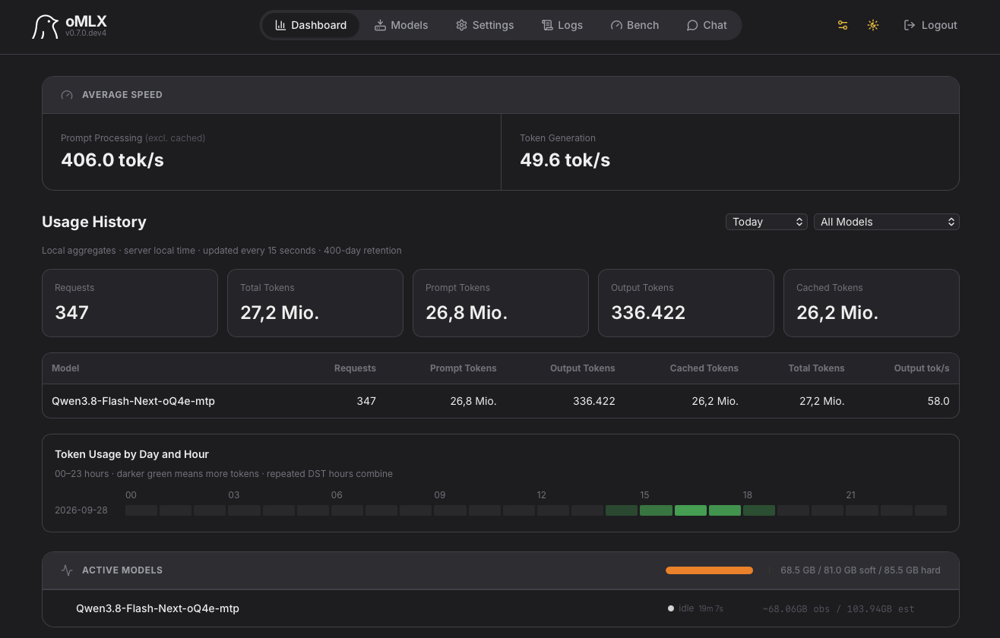

# 🧹 WITCH CART

A pseudo-3D kart racer that runs in the browser.

Built to see what Qwen3.8-Flash-Next creates with a single prompt.



## Run it

The page must be served over HTTP (WebAudio + no bundler needed):

```bash
python3 -m http.server 8080      # or: npm start
open http://localhost:8080
```

## Controls

| action | keyboard | gamepad-ish |
|---|---|---|
| drive | `↑` / `W` accelerate, `↓` / `S` brake & reverse | on-screen pads (touch) |
| steer | `← →` / `A D` | pads |
| drift | hold `SHIFT` while turning | `DRIFT` pad |
| item | `SPACE` | `ITEM` pad |
| start / confirm | `ENTER` | tap |
| pause | `P` | — |
| mute | `M` | — |

**Drifting** charges a mini-turbo: blue → orange → purple. Release the drift button
with a full meter for a shove of speed. **Hexes** zap every other racer on the
grid; **shells** home in on the leader and can be reflected off a wall into
whoever is behind you.


## How this was created
```
mkdir witch-cart
cd witch-cart
```

```
omlx launch pi
-> Qwen3.8-Flash-Next-oQ4e-mtp
```

```
build a mario cart style game that runs in the browser
please continue
please continue
```

Jundot/Qwen3.8-Flash-Next-oQ4e-mtp on Mac Studio M5 Ultra 96GB

## Architecture

Load order (see `index.html`) matters — each file hangs off the single `WC` global.

| file | role |
|---|---|
| `js/util.js` | math, seeded RNG (mulberry32), packed-pixel colour helpers |
| `js/track.js` | spline circuits, spatial hash, `sampleTrack`, ribbon/curb/wall geometry, decor scatter, 3 mip ground textures |
| `js/sprites.js` | every sprite baked onto offscreen canvases: karts (rear/side/front), decor, items, boxes, flags |
| `js/kart.js` | arcade car physics: grip circle, drift charge, kerb/wall/grass contact, laps |
| `js/ai.js` | opponent driver: speed triangle into corners, line offset, rubber-banding, item use |
| `js/items.js` | item boxes, weighted draw table, shells / bananas / hexes / stars |
| `js/particles.js` | smoke, flame, sparks, splash, weather (rain / embers / snow) |
| `js/render.js` | the Mode 7 renderer + sprite compositor + HUD hook |
| `js/audio.js` | WebAudio synth: engines, music, all sfx |
| `js/input.js` | keyboard + touch, per-frame edge detection |
| `js/game.js` | state machine (title → select → countdown → race → results), camera, ranking, HUD, minimap |
| `css/style.css` | cabinet chrome, menu screens, touch pads |

### Coordinate system

`x` right, `y` down the map, `z` up. For a heading `ang`, the forward vector is
`T = (cos, sin)` and the screen-right vector is `R = (-sin, cos)`; a positive
lateral offset is to the right of the direction of travel.

### The renderer

The ground is a per-scanline affine texture map. Each visible row resolves its
distance from the horizon (`dd = focal · camH / (sy - horizon)`), picks one of
three pre-baked mips so distant ground costs the same as near ground, and mixes
toward the sky's horizon colour for depth fog. Above the horizon: a precomputed
sky LUT plus sun, moon, stars and drifting cloud blobs.

Everything else — karts, decor, items, particles — is a billboard sorted by
distance and drawn back-to-front with squash, wobble, roll and drop shadows.
The whole scene is rasterised at **480×270** and upscaled with
`image-rendering: pixelated`; the HUD is painted in a 1280×720 space on top.

### Physics notes

The car is a slip box: engine force along the heading, lateral velocity bled off
by a grip constant (`8.6` on the road, `2.05` while drifting, lower on grass and
sand). Turning converts forward speed into lateral scrub, which is why power-slides
bleed momentum. The fence steers you — scraping a wall rotates the nose back down
the track rather than grinding you to a halt, and a kart that stalls for 1.4 s gets
settled back onto the ribbon.

## Tests

Pure-node harnesses, no browser, no libraries:

```bash
npm test
```

* **`test/geom.js`** — circuit integrity: spline closure, fence separation,
  quadrance error, wall widths, decor counts, per-course timing.
* **`test/race.js`** — race quality: eight AI-driven karts complete every circuit
  inside a sane window, lap times are plausible (no free laps), nobody escapes the
  fences, nobody stalls, contact stays reasonable, ranking is monotonic and the
  simulation is reproducible run to run.
* **`test/smoke.js`** — boots the whole game against a headless DOM/Canvas stub,
  drives the menus with synthetic key events, races, inspects the framebuffer
  (colour count, horizon height, non-blank pixels), exercises pause, shells,
  weather and every course.

## Looking at it without a browser

`test/raster.js` is a software Canvas 2D implementation (paths, quadratic curves,
gradients, transforms, a 5×7 bitmap font) that `tools/shot.js` uses to run the
real game headlessly and write PNGs — the way to eyeball a frame of geometry or
HUD spacing without opening Chrome:

```bash
npm run shot                          # one frame of every circuit -> /tmp/wc/*.png
node tools/shot.js --course=grim --at=600
node tools/shot.js --sprites        # the whole baked sprite sheet
node tools/shot.js --ground=hex     # the baked ground texture, 3 mips
```

`shot.js` flies the player with a lookahead autopilot so the captures show actual
racing lines instead of a kart wedged into the first fence.

## Tuning knobs

| where | knob |
|---|---|
| `js/track.js` | `LA` (loop anchor), node list, `hw` half-width, `wall`, decor density |
| `js/kart.js` | `SURF` grip/speed table, `gripK`, drift charge thresholds |
| `js/ai.js` | `targetSpeed` triangle constants, `off` line offset, skill band |
| `js/render.js` | `focal`, `HORIZON`, `VIEW` distance, fog falloff, `CAM_BACK` / `CAM_H` chase rig |
| `js/particles.js` | puff radius `r`/growth `gr` and lifetime per emitter |
| `js/game.js` | laps, countdown length, camera shake, catch-up rubber-banding |

MIT licensed. Built as a self-contained homage — all art and audio code, no rips.
